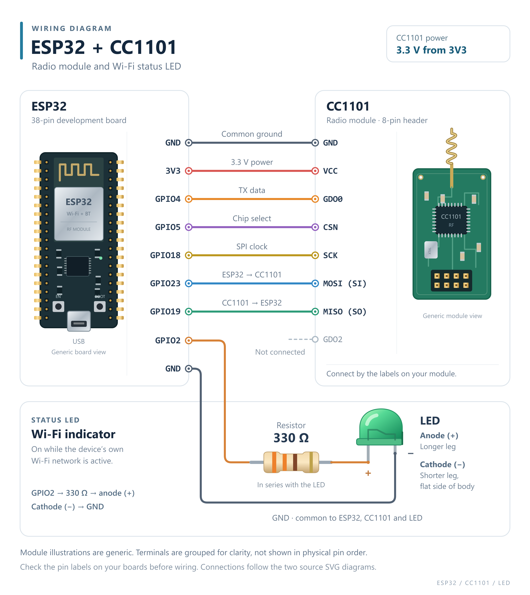

# Shutters Dongle

An ESP32 + CC1101 bridge that puts motorized shades and blinds on MQTT and Home Assistant by radio — no cloud, no gateway subscription, no vendor app.

## What it does

The dongle imitates a remote control. Every motor it's paired with sees it as one more remote sitting next to the original — physical remotes keep working exactly as before, nothing is taken over or disabled.

Up to **128 channels**, each an independent virtual remote that can drive one motor or a whole group of motors. Two protocols, freely mixed on the same dongle:

- **Somfy RTS** — 433.42 MHz, rolling code
- **A-OK** — 433.92 MHz, fixed code

Setup and day-to-day control both happen through the dongle's own web interface: no companion app, no account, nothing that depends on a vendor's servers staying online. Once it joins Wi-Fi, Home Assistant discovers it automatically.

The radio link is one-way: the dongle knows what it last sent, not the motor's real position. If someone drives a shade with the original remote, Home Assistant won't notice until the next command.

## First flash

The first flash goes over USB. Each release has two files:

- `shutters-dongle-<version>-full.bin` — for the first flash. Write it to address `0x0` with any ESP32 flasher, e.g. `esptool.py --chip esp32 write_flash 0x0 shutters-dongle-<version>-full.bin`.
- `shutters-dongle-<version>.bin` — for updates: from Home Assistant, or System → Firmware update.

Or build and flash from source: **Upload** in PlatformIO (`pio run -t upload`).

## Hardware

- ESP32 dev board (38-pin, external antenna connector) + antenna
- CC1101 radio module for 433 MHz + antenna
- LED and a ~330 Ω resistor for the status light
- panel-mount 5 V DC jack
- optional 3D-printed enclosure — see [`case/`](case/)

## Access and configuration

A freshly flashed dongle opens its own Wi-Fi access point — `ShuttersDongle-XXXXXX` by default, or a name you set yourself (see below) — protected by the default password `shutters`, which you're forced to replace on first connection. From there it's pointed at your home network; two networks can be configured; it joins whichever has the stronger signal and re-opens its own access point automatically if Wi-Fi is ever lost, so it's never unreachable for long. Holding the BOOT button for 10 s resets Wi-Fi and the password without touching channels or MQTT settings.

The access point name and network hostname (what shows up scanning for Wi-Fi or browsing your router's client list) can be replaced with a device name of your choosing on the System page — e.g. `shutter-kitchen` instead of a MAC-address string. Several dongles can run side by side (one per floor, one per room) without colliding, since every identifier is unique per device by default.

## Home Assistant

1. HACS → **Add from link** → `https://github.com/Endruch/Shutters-dongle` → **Add**.
2. **Install**, then restart Home Assistant.
3. **Settings → Devices & services → Discovered** → **Add**, enter the dongle's web password.

## MQTT

Topics follow `cmd|stat|tele/<device topic>/shutter/<channel>`. The device topic is unique per dongle by default (or follows the device name once one is set), so multiple dongles never collide on the same broker.

Commands, sent as the payload of `cmd/.../shutter/<n>`: `UP`, `DOWN`, `STOP`, `SHADE`, `SETSHADE`, `LEARN` (case-insensitive; `OPEN`/`CLOSE` accepted as aliases for `UP`/`DOWN`). `SHADE` and `SETSHADE` — go to, and store, a favourite position — exist only for Somfy.

Off by default; enter a broker address on the System page to turn it on. Don't combine *Home Assistant MQTT discovery* with the integration, or every shutter shows up twice.
